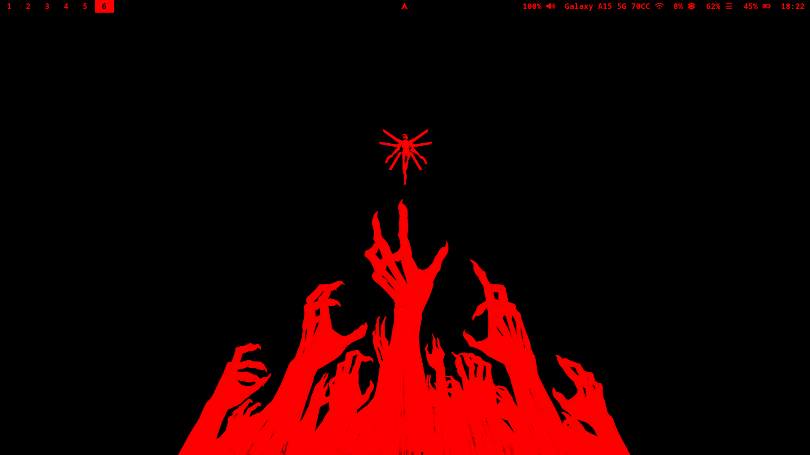
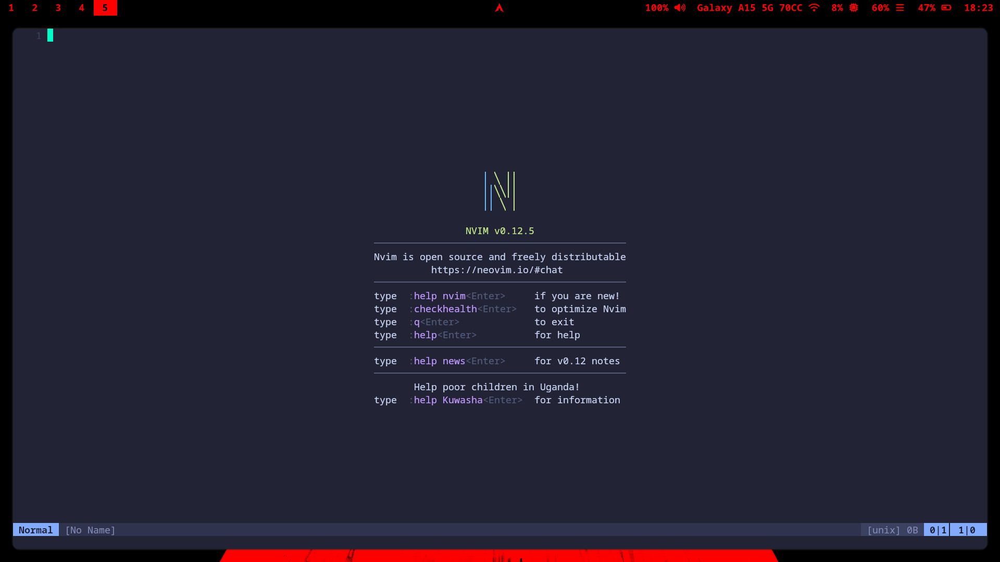

# 🩸 azdots

A minimal, aggressive red-and-black dotfile configuration for Arch Linux built around Hyprland, inspired by Ultrakill. By stripping away bloat and relying on lightweight components, this setup idles at just **~800 MB of RAM**.



## 📸 Overview
*   **Desktop/Hyprland:**
  
*   **Neovim:**
  


## 🚀 Installation

This setup is built specifically for **Arch Linux**. It includes an automated installation script that handles dependency installation, and securely copies the new configurations to your system.

### Quick Start
Clone the repository and run the setup script:

```bash
git clone https://github.com/0xhyprlarp/azdots.git
cd azdots
chmod +x install.sh
./install.sh
```

## ⌨️ Keybindings

This configuration maps `SUPER` (the Windows key) as the main modifier for all core actions.

### Core System
| Keybind | Action |
| :--- | :--- |
| `SUPER + Space` | Open App Launcher (Rofi) |
| `SUPER + T` | Open Terminal (Kitty) |
| `SUPER + F` | Open File Manager (Dolphin) |
| `SUPER + Q` | Close Active Window |
| `SUPER + Shift + Q` | Shutdown / Exit Hyprland |
| `SUPER + L` | Lock Screen (Hyprlock) |
| `PrintSrc` | Take Screenshot & Copy to Clipboard |

### Applications
*These applications aren't installed by default but if you install them in future you have the key binds here*
| Keybind | Action |
| :--- | :--- |
| `SUPER + B` | Web Browser (Firefox) |
| `SUPER + Shift + B` | Private Browser (Librewolf) |
| `SUPER + Shift + S` | Launch Steam |
| `SUPER + Shift + D` | Launch Discord |
| `SUPER + Shift + M` | Launch Spotify |
| `SUPER + Shift + C` | Text Editor (Lite-XL) |

### Window Management
*   **Move Focus:** `SUPER + Arrow Keys`
*   **Move Windows:** `SUPER + Left Mouse Button` (Click & Drag)
*   **Resize Windows:** `SUPER + Right Mouse Button` (Click & Drag)
*   **Toggle Float:** `SUPER + V`
*   **Workspaces:** `SUPER + [1-0]` (Switch Workspace), `SUPER + Shift + [1-0]` (Move Window to Workspace)

### Media & Hardware
*Media keys on laptops (Volume up/down, Mute, Mic Mute, Brightness up/down, Play/Pause) are automatically mapped to Pipewire and Brightnessctl commands.*

---

## 🖤 Credits & Acknowledgments

*   Massive thanks to the **FOSS Community** and the incredibly thorough **Hyprland Documentation**. Building a system that idles below 1GB of RAM is only possible because of these resources.
*   The Neovim setup is built upon the blazing fast [nvim-light](https://github.com/VonHeikemen/nvim-light) configuration by VonHeikemen.

## 📄 License

This project is licensed under the MIT License.
